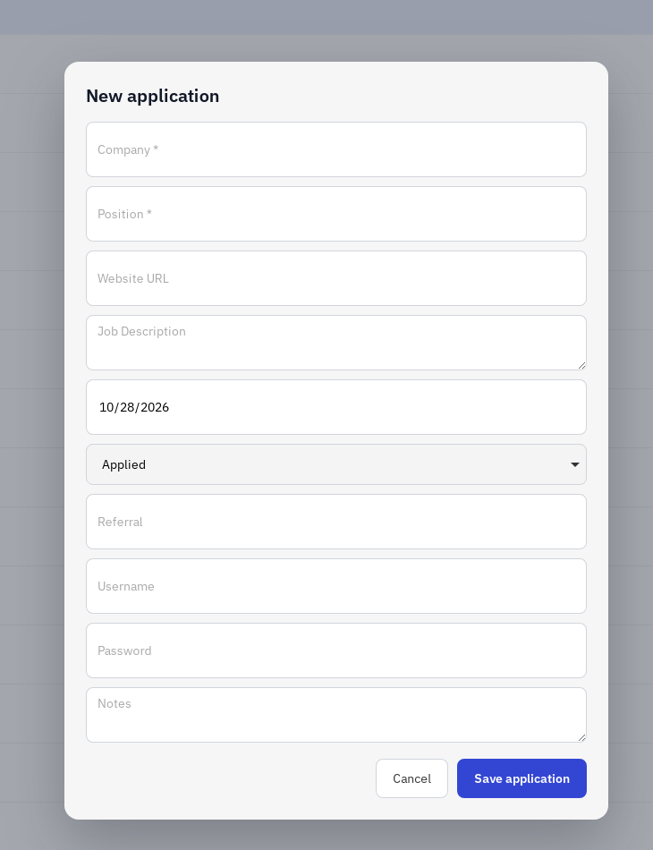
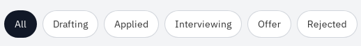
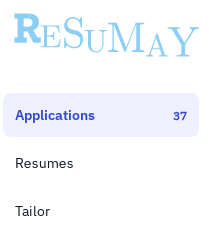
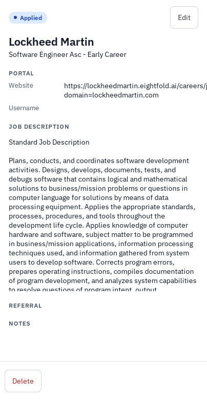
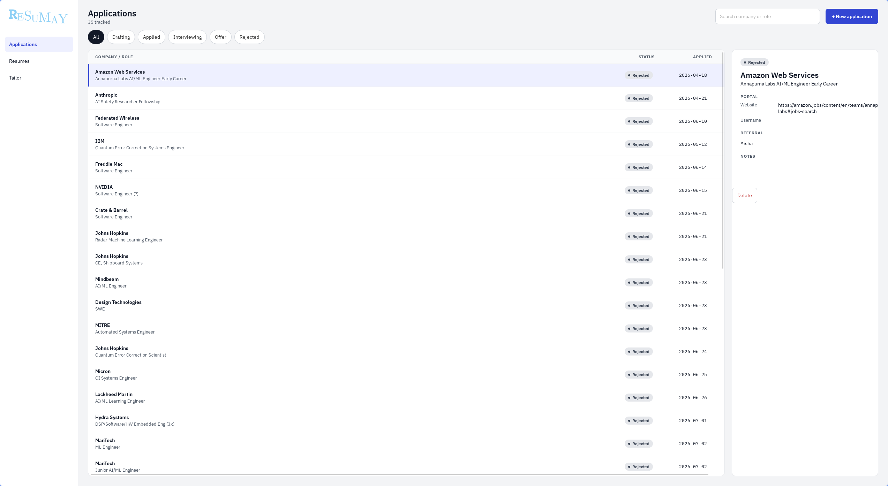

Resume tracking application, to keep track of the mass amounts of applications SWE's have to send out now. Built with Svelte, HTML, JavaScript, Rust, SQLite, Tectonic, and bundled with Tauri.

# Resumay

Are you (likely) a CS graduate or something in the tech-STEM fields and are currently fighting the hordes and masses applying for single positions? Are you using AI to do so? Are you also losing track of your applications and would at least like a ledger of your (futile) attempts against the machine? Well look no further!

Resumay is a fast, lightweight desktop app for tracking your job applications. 

You can store information about each application and log the day you applied. 

    

You can divide them into the stages of each application to keep track of your progress as you make your way through the slurry of applications and positions! 

    

It certainly isn't easy to keep that excel sheet going much longer...

Keep track of how many places you've applied just to get a little more down about it! (More features to come!)

    

Check out the details of each application to remind yourself just where you *aren't* getting accepted to!

    

## WIP

Currently still working on it. In 'Alpha', if you will.

