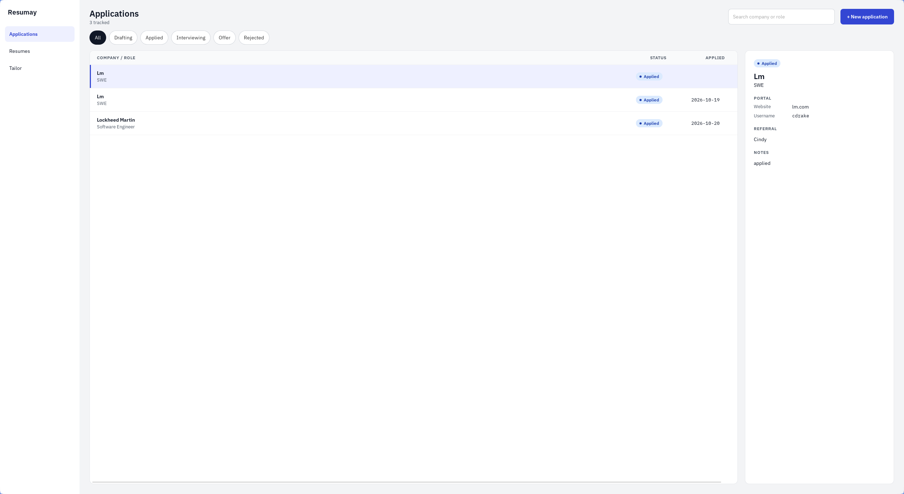

Resume tracking application, to keep track of the mass amounts of applications SWE's have to send out now. Built with Svelte, HTML, JavaScript, Rust, SQLite, Tectonic, and bundled with Tauri.

## WIP

Currently still working on it. In 'Alpha', if you will.

